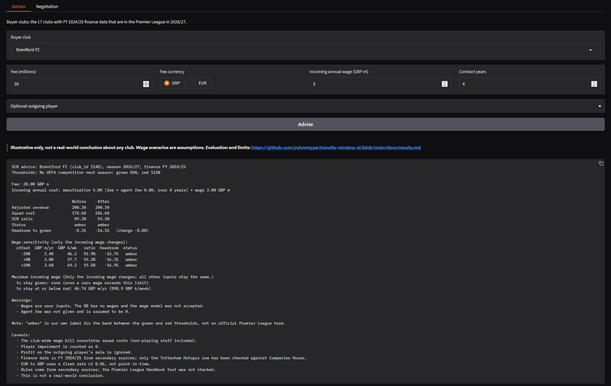
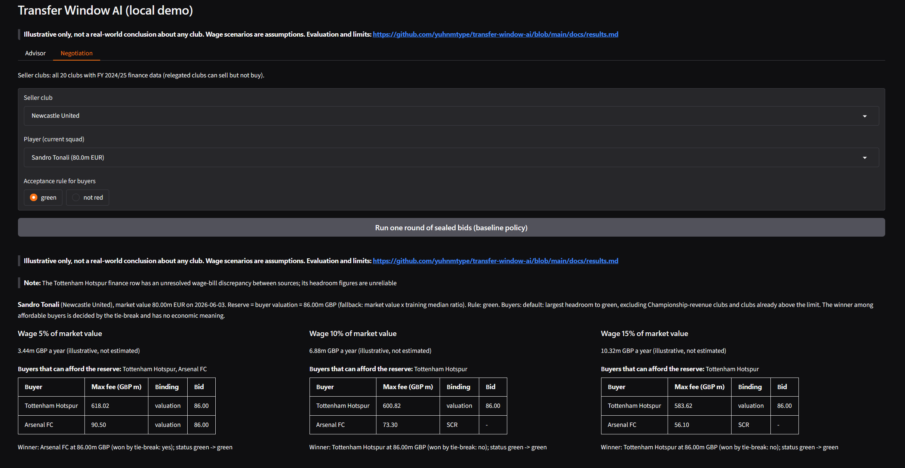

# Transfer Window AI

A rules engine, advisor and negotiation simulator for Premier League transfer deals under the
2026/27 squad cost ratio (SCR) rules, built on a frozen Transfermarkt snapshot (2026-07-11).
Code computes every fee and SCR figure; two language-model agents (Google ADK with Gemini) were
added only to adjust a valuation within a fixed band, and their effect was tested in a
pre-registered evaluation. The learned fee model and the LLM agents did not beat a simple
market-value-ratio fallback on the registered test split, and the project reports this as its
main empirical result. All figures are illustrative: this is not a real-world transfer
predictor and not a production system. **Nothing here is a real-world conclusion about any
club.**

## What it does

- **Rules engine (SCR).** For a buying club it computes adjusted revenue, squad cost, the SCR
  ratio and the headroom to the green and red thresholds (85% and 115%, or 70% and 100% for
  clubs in UEFA competitions). Rules live in `config/rules_2026_27.toml`, so the engine itself
  is not tied to one season.
- **One-deal advisor.** For a hypothetical permanent deal (fee, wage, contract length,
  optional outgoing player) it shows the SCR before and after, a wage sensitivity table and the
  largest wage that keeps the club within each threshold. The outgoing player's amortisation
  can be looked up from the transfer history (an approximation, flagged as such) or supplied
  by the user.
- **Fee model.** A small OLS model of `ln(fee / point-in-time market value)`. It did not pass
  its accuracy criterion, so the seller reserve uses the registered fallback, market value x
  1.25 (the training median ratio).
- **Negotiation engine.** One seller, 2-3 buyers, one round of sealed bids with a rule-based
  baseline policy. A buyer's ceiling is the largest fee that keeps it within the SCR limit,
  computed analytically. Every result is reported for three illustrative wage scenarios (5%,
  10% and 15% of market value), never for one. Two demo runs are in
  [`docs/demo_deals.md`](docs/demo_deals.md): for the same player, the set of buyers that can
  afford the reserve changes with the assumed wage (in the Tonali example, two buyers at 5%, one
  at 10% and 15%).
- **LLM agents.** A seller agent and a buyer agent (ADK `LlmAgent`, `gemini-3.5-flash-lite`,
  temperature 0) each return one factor for the reference fee, with a short rationale. Code
  validates the output, clips the factor into a registered band and combines the two factors;
  the model never computes a fee or an SCR figure.

## Evaluation and negative results

| Model | Test set | Registered result | Used in the system |
|---|---|---|---|
| Wage model | 8 test clubs | Not accepted: 3 of 8 passes against 5 of 8 for an equal split | No: wages are user inputs or labelled scenarios |
| Fee model | 206 test transfers | Criterion A failed (MdAPE ratio 1.242); 80% interval calibrated (coverage 0.801) | Only the fallback, market value x 1.25; the interval is kept as the allowed band |
| LLM agents (blind) | 206 test transfers | Criterion A failed, did not beat the fallback (MdAPE ratio 1.348); criterion V passed (1.000) | No: the baseline policy (factor 1) is the default; the LLM policy is used only for the ablation |
| Named-prompt diagnostic | 50 test transfers | Report only: MdAPE 0.308 against 0.357 for the blind prompts on the same rows | No: it gates nothing |
| Window-level backtest of the fallback | 6 windows, S2023 to W2026 | Descriptive only, no pass/fail: MdAPE per window from 0.250 to 0.573 | No: it changes no parameter or default |

Every model was evaluated the same way: the data filters, split, metrics and acceptance rules
were written down and committed under a git tag **before** the evaluation script existed and
before any model code touched the test split, and the evaluation script refuses to run if
anything frozen has changed. Each registered evaluation produced exactly one result file
(run 1; there is no run 2). The blind LLM arm was completed in
two invocations: an earlier one wrote 11 cache entries and stopped, and the invocation that
completed the run reused them from the on-disk cache; all cache entries were committed together
with the result. Full tables are in [`docs/results.md`](docs/results.md).

- **Wage model** (`wage-criteria-v1`): not accepted. It passed 3 of 8 test clubs against 5 of 8
  for an equal split. Wages are therefore user inputs, and simulations use labelled scenarios.
- **Fee model** (`fee-criteria-v1`): accuracy criterion A failed (MdAPE ratio 1.242 against a
  required 0.90 or lower; bootstrap interval [-0.016, 0.093]); the 80% interval passed its
  calibration criterion (coverage 0.801). The fallback, market value x 1.25, is used instead.
- **LLM agents** (`llm-criteria-v1`, 206 test transfers): criterion A failed. The LLM-adjusted
  fee did not beat the fallback: MdAPE ratio 1.348, and the paired bootstrap interval of
  MdAPE_LLM - MdAPE_fallback is [+0.041, +0.140]. On this split the median error was higher
  than the fallback's; this is a descriptive result for this split and configuration, not a
  general claim. Validity criterion V passed (valid share 1.000 of the 412 calls).
- **Named-prompt diagnostic** (report only, 50 rows): adding the player and club names gave an
  MdAPE of 0.308 against 0.357 for the blind prompts on the same rows. The cause is not
  established, and leakage through the model's memory cannot be excluded, because the model's
  knowledge cutoff (March 2026) covers the whole test window.
- **Window-level backtest** (`backtest-criteria-v1`, descriptive only): the fallback's MdAPE per
  transfer window ranges from 0.250 (S2025) to 0.573 (W2024, 16 rows, low precision); most
  bootstrap intervals overlap, so the table shows neither stability nor drift. It is not a
  validation. See [`docs/results.md`](docs/results.md).

What it means, as registered: the baseline policy (factor 1) stays the default in the
negotiation engine, and the LLM policy is experimental and used only for the ablation. Nothing
was rerun or tuned after the results; a new prompt experiment would need a new tag
(`llm-criteria-v2`).

## How to run

The core runs on Python 3.11+ (tested on 3.15); the LLM layer uses a separate venv with
Python 3.13 and google-adk 2.12.0. Commands are for PowerShell on Windows.

```powershell
git clone https://github.com/yuhnmtype/transfer-window-ai.git
cd transfer-window-ai
python -m pip install -r requirements.txt

python src\phase1_build_db.py          # downloads the dataset via kagglehub, builds the SQLite DB
python src\phase2_load_seed.py         # validates and loads the finance seed
python src\phase2_check_sources.py     # cross-checks the seed against its source table
python -m pytest                       # unit tests (ADK tests are skipped without google-adk)

python src\advise_cli.py --list-clubs
python src\advise_cli.py --club-id 1148 --fee 20 --fee-currency GBP --wage-gbp-m 3 --contract-years 4
python src\negotiate_cli.py --seller-club-id 762 --player-id 397033 --rule green
```

LLM layer: the results were produced in a venv named `.venv-adk` with Python 3.13.16 and
google-adk 2.12.0. One way to create it, if a Python 3.13 interpreter is available (these setup
commands are an example and were not re-run for this README):

```powershell
py -3.13 -m venv .venv-adk
.\.venv-adk\Scripts\python.exe -m pip install -r requirements.txt google-adk==2.12.0
.\.venv-adk\Scripts\python.exe -m pytest     # full suite, including the ADK tests with a fake model
```

The LLM scripts read the API key from the `GOOGLE_API_KEY` environment variable through the
ADK/GenAI client. The key is never written to a file, and the committed response cache contains
no key or request headers. The registered evaluation commands and the reproduction notes are in
[`docs/results.md`](docs/results.md#how-to-reproduce).

### Local demo

A local Gradio app (`src/demo_app.py`) wraps the one-deal advisor and the negotiation engine.
It runs on your machine only, never calls a language model, needs no API key, uses the
rule-based baseline policy only, and always shows the three wage scenarios and the
illustrative-only banner. Build the database first (`python src\phase1_build_db.py`, then
`python src\phase2_load_seed.py`), then use a separate venv named `.venv-demo` with Python
3.13. An equivalent setup (the same interpreter, 3.13.16, and gradio 6.30.0) was used to create
`.venv-demo`; the exact commands shown here were not re-run for this README.

```powershell
py -3.13 -m venv .venv-demo
.\.venv-demo\Scripts\python.exe -m pip install -r requirements-demo.txt   # includes gradio==6.30.0
.\.venv-demo\Scripts\python.exe src\demo_app.py
```

Then open http://127.0.0.1:7860.





Screenshots of the local Gradio demo; the demo is not publicly hosted. Illustrative only, not a
real-world conclusion about any club; wage scenarios are assumptions. In the negotiation
screenshot, the large max fee for Tottenham Hotspur is an SCR headroom ceiling (headroom
multiplied by the assumed contract length), not a prediction and not a cash check; its finance
row was checked against the filed accounts (see Limitations).

## Reproducibility

- Criteria are frozen by git tags (`wage-criteria-v1`, `fee-criteria-v1`, `llm-criteria-v1`);
  the scripts check them with `git diff --quiet <tag> -- <file>` before running.
- Prompt templates are frozen with their SHA-256 hashes (recorded in `docs/llm_criteria.md`).
- Every LLM response is cached on disk and the cache is committed. The 412 blind calls map to
  392 cache files, because 10 test rows have exactly the same prompt as another row and share
  its cached response.
- Each result file has a provenance block: code commit, tag commit, data checksums or the
  fee-results checksum, library versions, seeds and generation settings.
- The test suite has 417 tests (from a `pytest --collect-only` run on 2026-10-28, in both the
  google-adk venv and the demo venv; tests that need a package missing from a venv are skipped
  there). They use synthetic data and a fake model, and never read the real test split.

## Data and provenance

- **Players, transfers, valuations:** Kaggle `davidcariboo/player-scores` (Transfermarkt
  scrape, CC0), frozen snapshot 2026-07-11. Checksums are in `DATA_VERSION.md`.
- **Club finances (FY 2024/25):** `seed/club_finance_seed.csv`, built from secondary sources
  (Swiss Ramble, PSRwatch and others) and cross-checked against `seed/club_finance_sources.csv`
  (47 source rows). Not checked against Companies House, except the Tottenham Hotspur row,
  which was checked against its filed consolidated accounts on 2026-10-27. Every seed row has a
  source URL and a confidence level.
- **Rejected source:** the "Global Football Transfer Market 2010-2026" dataset (Nefedov) was
  rejected because it appears to be mostly synthetic.
- The database contains the 20 clubs of the 2025/26 Premier League; the three newly promoted
  clubs are not included.

## Limitations

- One time-based split (train 1,154, calibration 185, test 206 transfers); the LLM test uses
  n = 206, and the named diagnostic n = 50. One model and one generation configuration.
- The wage model evaluation rests on n = 8 test clubs (Wilson 95% interval for the model pass
  rate [0.137, 0.694]), so it is a weak test either way.
- The seller agent leans upwards: its seller-only MdAPE ratio is 1.75 against 1.20 for the
  buyer-only ratio, and the prompt states a reference fee that can anchor both agents. These
  numbers, and the placebo percentile of 4.2, are report-only.
- Wage scenarios (5%, 10%, 15% of market value) are illustrative, not estimated; contracts in
  the negotiation engine are assumed to run 5 years; EUR is converted at a fixed 0.86 GBP.
- Finance data is FY 2024/25 from secondary sources, with no revenue growth applied; the seed
  wage bill is club-wide and overstates squad costs; impairment is counted as 0; profit on the
  outgoing player's sale is ignored; Leeds, Sunderland and Burnley have Championship revenue.
- Tottenham Hotspur's finance row agrees, within rounding, with its filed FY 2024/25
  consolidated accounts (Companies House 01706358; see `seed/SOURCES.md`). Its wage bill
  (256m) is group-wide staff costs, including stadium and retail staff, so it overstates squad
  cost; the demo shows a note whenever Tottenham is in a result.
- SCR rules come from secondary sources; the Premier League Handbook text was not checked.
- The SCR engine has not been validated against real outcomes: the finance seed is FY 2024/25
  only and was published between December 2025 and May 2026, so it cannot be shown to be
  point-in-time for any complete window in the data (S2023 to W2026; the repository does not
  record filing dates per club), and the upstream dataset updates are paused (current to
  6 July 2026 per the Kaggle page).
- Current squads are approximated from the dataset (mean absolute difference of 3.55 players
  against official squads, `DATA_VERSION.md`).
- Permanent deals only; loans and the GBE (work permit) rules are not implemented.

## Project status

Done: data foundation, finance seed, SCR rules engine, one-deal advisor, outgoing-player
amortisation helper, negotiation engine v1 with a rule-based baseline, pre-registered
evaluations of the wage model, the fee model and the LLM agents, a local Gradio demo, and a
limited descriptive window-level backtest of the fee fallback.

Future work: a forward validation on the summer 2026 window, only if new data becomes
available. Counter rounds, a player decision model and Monte Carlo runs for the negotiation
engine are not started.

## License

Code: MIT, see `LICENSE`. The Kaggle dataset is CC0. Finance figures were compiled from the
public sources listed in `seed/`.
